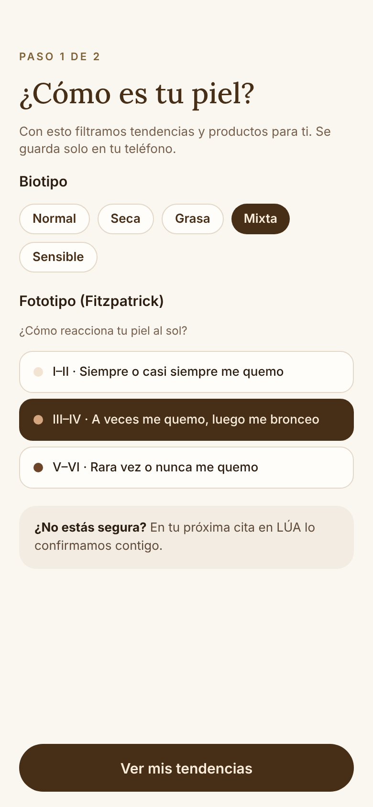
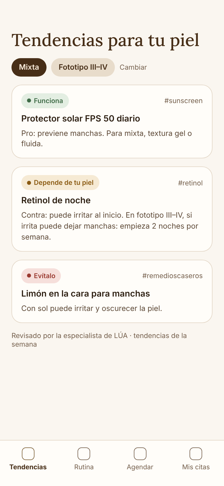
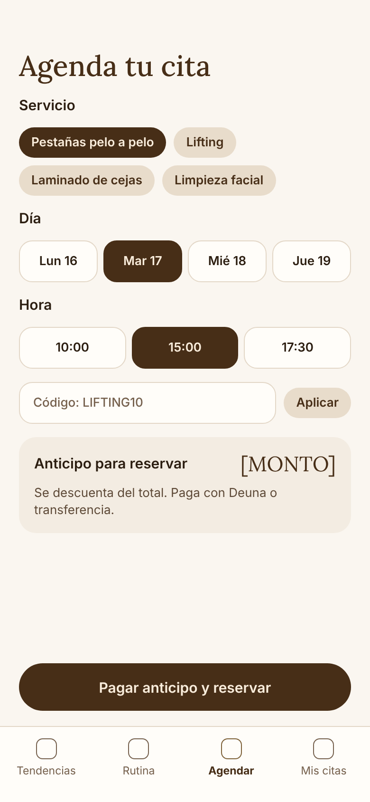
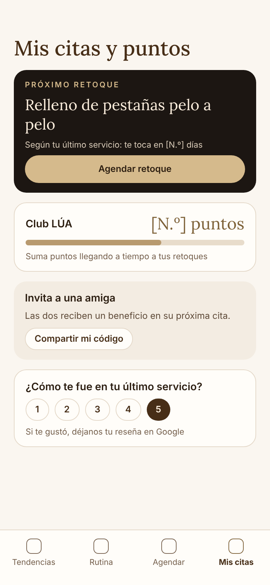
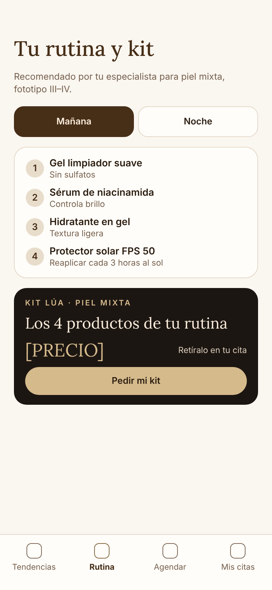
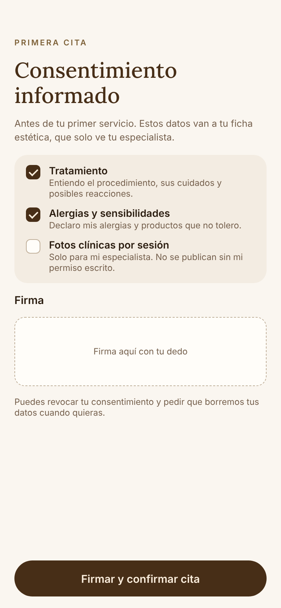
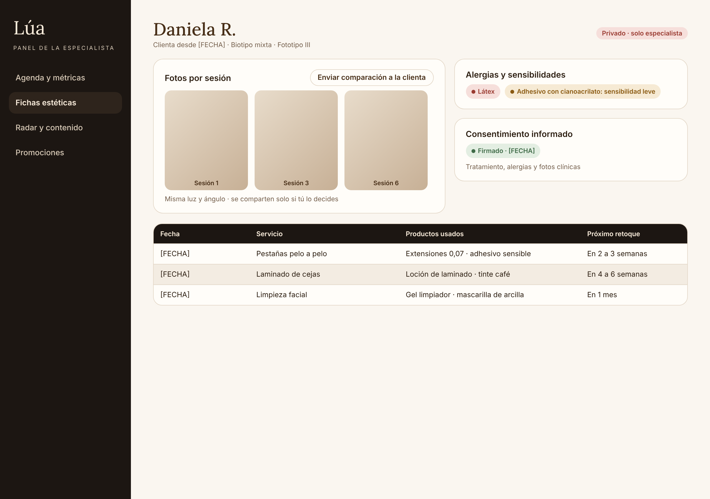
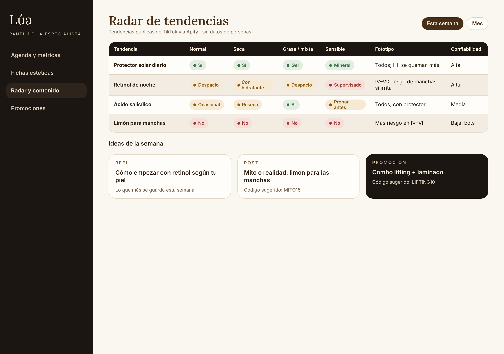

# Mi Piel LÚA

App móvil para **LÚA Studio** (spa de estética en Quito, [@lua.studio.ec](https://www.instagram.com/lua.studio.ec/)).
La app le dice a cada clienta si una tendencia viral de skincare **le sirve a su piel**, según su
**biotipo** y **fototipo**. También le permite **agendar su cita con anticipo** y le recuerda **cuándo le toca su retoque**.

> Proyecto académico · Materia: **Dispositivos Móviles**

---

## 🎨 Diseño en Figma

**Prototipo y línea gráfica:** https://www.figma.com/design/4W1AwtCVztFHCuAryeh7hM

---

## 1. Problema

- En TikTok e Instagram se viralizan a diario rutinas, productos y "trucos" faciales (retinol, ácidos,
  limón en la cara…). Las clientas los prueban **sin saber si sirven para su tipo de piel**. Algunos
  causan irritación, manchas o quemaduras, sobre todo en Quito, donde la radiación UV es muy alta.
- La especialista responde las mismas dudas una y otra vez por WhatsApp.
- No hay un recordatorio de **cuándo toca el retoque** (pestañas, lifting, laminado, limpieza). Se pierden
  citas y el ingreso es irregular.
- Las reservas se pierden cuando la clienta no deja un **anticipo**.
- La ficha de cada paciente (historial, alergias, consentimiento, fotos de antes y después) está en papel
  o dispersa en el chat.
- Las promociones en redes se publican sin saber **cuál trajo clientas**.

## 2. Negocio

**LÚA Studio** es un spa de estética facial y de mirada en Quito, atendido por una **dermatocosmiatra**.

**Propuesta de valor:** *"Lo viral, revisado por tu especialista para tu piel."*

| Para la clienta | Para LÚA (la especialista) |
| --- | --- |
| Semáforo por tendencia: **Funciona / Depende de tu piel / Evítalo**, según su biotipo (normal, seca, grasa, mixta, sensible) y fototipo (Fitzpatrick I–VI) | **Radar de tendencias** (Apify + TikTok), solo con métricas generales de hashtags y sin datos de personas |
| Agenda con **anticipo** por Deuna o transferencia | Ideas de contenido y promociones según lo que es tendencia |
| **Recordatorio de retoque** según el servicio realizado | **Códigos de promoción** medibles (ej. `LIFTING10`) |
| **Club LÚA**: puntos y referidas | **Ficha estética** con consentimiento informado y fotos de antes y después (**solo la especialista las ve**) |
| Rutina y kits según su piel | Métricas, encuesta de satisfacción y reseña en Google |

**Diferenciador:** las apps genéricas de skincare no conocen a la clienta ni a su especialista. En
Mi Piel LÚA cada tendencia la **valida una profesional** y la recomendación termina en una **cita real** del spa.

**Modelo:** la app es gratuita para las clientas. Genera ingresos para el spa con más citas, retoques a
tiempo, venta de kits y referidas.

### Módulo en desarrollo

🧪 **Análisis facial con IA.** Conecta los resultados del analizador facial del spa con IA para
sugerir tratamientos y productos por cada inestetismo. **Siempre lo aprueba la especialista**
(Ley Orgánica de Protección de Datos Personales del Ecuador, art. 20). En la app aparece como
"En desarrollo".

## 3. Integrantes

| Nombre | Rol |
| --- | --- |
| _Por completar_ | _Por completar_ |
| _Por completar_ | _Por completar_ |

## 4. Inteligencia artificial utilizada

Usamos **Claude (Anthropic)** como asistente en la idea de negocio, la investigación, el diseño en Figma,
el modelado DDD, el código, las pruebas y la documentación. El detalle está en [`docs/IA.md`](docs/IA.md).

## 5. Tecnología y metodología

| | |
| --- | --- |
| **Framework** | React Native con **Expo Go** (Expo SDK 58) |
| **Lenguaje** | TypeScript (modo estricto) |
| **Metodología** | **DDD — Domain-Driven Design** |
| **Diseño** | **Figma** (línea gráfica, atomic design, prototipo) |
| **Radar de tendencias** | Apify · actor `clockworks/tiktok-scraper` (solo backend) |
| **Pruebas** | `node:test` sobre la capa de dominio |

### Arquitectura DDD

```
src/
├── domain/            ← Reglas de negocio puras (sin React, sin APIs)
│   ├── piel/          Biotipo, Fototipo, PerfilPiel
│   ├── tendencias/    Tendencia, Semáforo, Confiabilidad (Ley de Benford)
│   ├── citas/         Cita, Anticipo, CódigoPromoción, Servicio, CalculadorRetoque
│   ├── fidelizacion/  Club LÚA
│   └── ficha/         Ficha estética, Consentimiento, Análisis facial (en desarrollo)
├── application/       ← Casos de uso
├── infrastructure/    ← Repositorios, gateway Apify, contenedor de dependencias
└── presentation/      ← Pantallas y componentes React Native
```

Más detalle en [`docs/ARQUITECTURA.md`](docs/ARQUITECTURA.md).

## 6. Cómo ejecutarlo

Requisitos: **Node.js 22.13 o superior** y la app **Expo Go** en el celular.

```bash
git clone https://github.com/msrodriguezv/mi-piel-lua.git
cd mi-piel-lua
npm install
npx expo install react react-native expo-status-bar react-native-safe-area-context
npm install -D typescript @types/react @types/node
npx expo start
```

Escanea el código QR con **Expo Go** (Android) o con la cámara (iPhone).

> Si tu Expo Go pide otra versión del SDK, ejecuta `npx expo install expo@latest --fix`.

Pruebas del dominio:

```bash
npm test
```

## 7. Pantallas

| Mi piel | Tendencias | Agendar | Mis citas |
| --- | --- | --- | --- |
|  |  |  |  |

| Rutina | Consentimiento | Panel: ficha | Panel: radar |
| --- | --- | --- | --- |
|  |  |  |  |

## 8. Privacidad

- El biotipo y el fototipo se guardan **solo en el teléfono** de la clienta.
- El radar de tendencias usa **solo métricas generales de hashtags**: no guarda perfiles, nombres ni comentarios.
- Las fotos de antes y después y la ficha estética son **solo para la especialista**, con consentimiento informado.
- El token de Apify **nunca** va dentro de la app (ver `.env.example`).

---

© LÚA Studio · Quito, Ecuador
