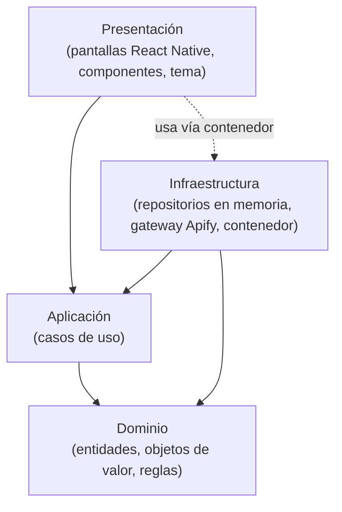

# Arquitectura — Mi Piel LÚA (DDD)

La app sigue **Domain-Driven Design** con cuatro capas. Las dependencias apuntan
siempre hacia el dominio: el dominio no conoce React Native, ni Apify, ni la base de datos.

## Contextos delimitados (bounded contexts)

| Contexto | Qué resuelve | Piezas principales |
| --- | --- | --- |
| **Piel** | El perfil cutáneo de la clienta | `Biotipo`, `Fototipo` (objeto de valor, Fitzpatrick I–VI), `PerfilPiel` |
| **Tendencias** | ¿Esta tendencia viral le sirve a mi piel? | `Tendencia` (entidad), `Semaforo`, `ConfiabilidadBenford`, `TendenciaRepository` |
| **Citas** | Agenda, anticipo, promociones y retoques | `Cita` (raíz de agregado), `Anticipo`, `CodigoPromocion`, `Servicio`, `CalculadorRetoque` |
| **Fidelización** | Club LÚA: puntos y referidas | `CuentaClubLua` |
| **Ficha estética** | Historial, alergias, consentimiento y fotos (solo especialista) | `FichaEstetica`, `ConsentimientoInformado`, `AnalisisFacial` *(en desarrollo)* |

## Reglas de negocio que vive el dominio

- Una **tendencia** solo se muestra si la especialista la validó y su confiabilidad no es baja.
- La **confiabilidad** de las métricas de una tendencia se mide con la **Ley de Benford** (MAD de Nigrini):
  ≤ 0,012 alta · ≤ 0,015 media · mayor, baja · menos de 50 datos, insuficiente.
  Sirve para detectar tendencias "infladas" con vistas artificiales.
- Una **cita** solo se confirma con **anticipo** (Deuna o transferencia).
- La **primera cita** no puede realizarse sin el **consentimiento informado** firmado.
- El **retoque** se calcula por servicio (pestañas 14–21 días, lifting 42–56, laminado 28–42, limpieza 28–35).
- Las **fotos clínicas** (antes/después) solo las ve el rol `especialista`.
- El **análisis facial con IA** solo sugiere; la especialista aprueba (LOPDP Ecuador, art. 20).

## Casos de uso (capa de aplicación)

| Caso de uso | Descripción |
| --- | --- |
| `ObtenerTendenciasParaMiPiel` | Filtra las tendencias publicables y las ordena por semáforo para el perfil |
| `AgendarCita` | Valida fecha futura y código de promoción, crea la cita pendiente de anticipo |
| `RegistrarPagoAnticipo` | Registra el anticipo y confirma la cita |
| `CalcularProximoRetoque` | Toma la última cita realizada de cada servicio y calcula la ventana de retoque |
| `MarcarCitaRealizada` | La especialista cierra la cita; exige consentimiento en la primera |
| `CancelarCita` | Cancela una cita pendiente o confirmada |
| `SubirFotoClinica` | Sube una foto solo si la clienta autorizó fotos clínicas |

Puertos de la capa de aplicación: `AutenticacionGateway` (sesión y roles) y `PanelEspecialistaRepository`
(modelo de lectura y escritura del panel).

## Infraestructura

- **Repositorios de Supabase** (`infrastructure/supabase/`): implementan los mismos puertos del dominio
  contra PostgreSQL. Las reglas críticas también viven en la base de datos (triggers y RLS).
- **Repositorios en memoria** con datos semilla: modo demostración cuando no hay `.env`.
- **`ApifyTendenciaGateway`**: consulta hashtags con el actor `clockworks/tiktok-scraper`.
  Corre **solo en backend/scripts**; el token nunca va en la app. Guarda únicamente métricas
  agregadas (número de vistas), nunca datos de personas.
- **`contenedor.ts`**: raíz de composición (inyección de dependencias manual).

## Privacidad (LOPDP Ecuador)

| Dato | Dónde vive | Quién lo ve |
| --- | --- | --- |
| Biotipo y fototipo | Solo en el teléfono | La clienta |
| Tendencias | Métricas agregadas de hashtags | Todas |
| Ficha estética y fotos | Panel de la especialista | Solo la especialista |
